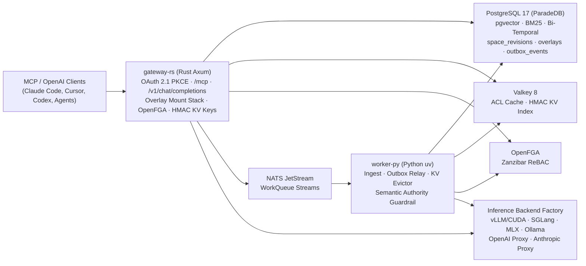

# Architecture

Project Convergent separates the **Hot Data Plane** (Rust) from **Async Workers** (Python) and **Inference Engines** (pluggable backend factory), anchored on single-ACID `PostgreSQL 17`, `Valkey 8`, `OpenFGA`, and `NATS JetStream`.

---

## Core Primitives

| Primitive | Storage / Mechanism | Role |
|---|---|---|
| **`Revision (rev)`** | `space_revisions` + `knowledge_blocks.landed_rev` | Single monotonic integer per Space. Eliminates branch DAG sprawl and powers `as_of` replay and `undo_revision`. |
| **`Mount Stack`** | `Base(space) ⊕ Overlay(delta)` | Zero-copy read composition. Untouched base blocks keep shared `space:{id}` KV cache keys for 100% reuse across concurrent agents. |
| **`Overlay`** | `overlays` + `overlay_deltas` | 0-byte virtual sandbox pinned to `base_rev`. Stores only the mutated `upsert`/`retract` deltas. |
| **`Changeset → Land`** | `pg_advisory_xact_lock` + optimistic check | Auto-rebases non-overlapping concurrent writes to `rev + 1`; returns structured `conflict` on true overlaps; emits `convergent.memory.superseded` for targeted KV eviction. |
| **`Smart Cache`** | `HMAC-SHA256` per-scope KV keys + `mlx-kv` / `LMCache` | Prevents cross-scope KV timing side-channels (`PROMPTPEEK`/`SpliceLeak`), splices non-prefix blocks (`CacheBlend`), and evicts stale tensors on `Land`/`Undo`. |

---

## Pluggable Inference Backend Factory

Configured via `CONVERGENT_INFERENCE_BACKEND` across both [gateway-rs/src/backends.rs](../gateway-rs/src/backends.rs) and [worker-py/src/convergent_worker/backends.py](../worker-py/src/convergent_worker/backends.py):

| Backend Value | Target | Engine | Cache / Pre-Warm Strategy |
|---|---|---|---|
| `vllm` / `cuda` | NVIDIA CUDA | `vLLM + LMCache` (`CacheBlend`) | Native `extra_body.kv_cache_keys`, `max_tokens=1` prefill warmup |
| `sglang` | NVIDIA CUDA | `SGLang` (`RadixAttention`) | `extra_body.radix_cache_keys`, `max_tokens=1` prefill warmup |
| `mlx` / `apple-silicon` | Apple Silicon Metal | `mlx_lm.server` / `mlx-kv` | Gateway Valkey KV tracking + `mlx-kv` `.safetensors` tensor store |
| `ollama` | Metal / CUDA / CPU | `Ollama` | Gateway Valkey KV tracking + `/api/generate` (`num_predict=1`, `keep_alive=10m`) |
| `openai` | Cloud Proxy | OpenAI API | Branch/space HMAC mapped to `prompt_cache_key` (auto-busts on `Land`/`Undo`) |
| `anthropic` | Cloud Proxy | Anthropic Messages API | System context wrapped with `cache_control: {"type": "ephemeral"}` |
| `dev` | Local | `scripts/dev_vllm_server.py` | Deterministic KV-hit simulator for fast CI |

---

## Gateway Surface (`gateway-rs`)

### HTTP Endpoints
- `GET /healthz` — Service status, active backend name & hardware target.
- `POST /oauth/authorize` & `POST /oauth/token` — OAuth 2.1 PKCE (`S256`) issuing HS256 JWTs.
- `POST /mcp` — MCP Streamable HTTP (JSON-RPC 2.0).
- `GET /v1/models` & `POST /v1/chat/completions` — OpenAI-compatible proxy (JSON & SSE streaming).
  - Request headers: `X-Convergent-Space: <uuid>`, optional `X-Convergent-Overlay: <uuid>`.
  - Response headers: `x-convergent-backend`, `x-convergent-overlay`, `x-convergent-cache-hits`, `x-convergent-kv-blocks`, `x-convergent-proxy-overhead-ms`.
- `POST /v1/spaces/{space_id}/grants` — Grant/revoke OpenFGA `viewer`/`editor`/`restricted` tuples with immediate Valkey ACL invalidation.
- `GET /v1/memory/history?source_uri=...&as_of=...` — Authorized bi-temporal point-in-time block lookup.

### MCP Tools (`POST /mcp`)
1. `list_spaces`
2. `search_memory` *(supports `space_id`, `overlay_id`, `top_k`)*
3. `get_block`
4. `ingest_note`
5. `open_overlay`
6. `stage_delta`
7. `inspect_overlay`
8. `land_overlay`
9. `undo_revision`
